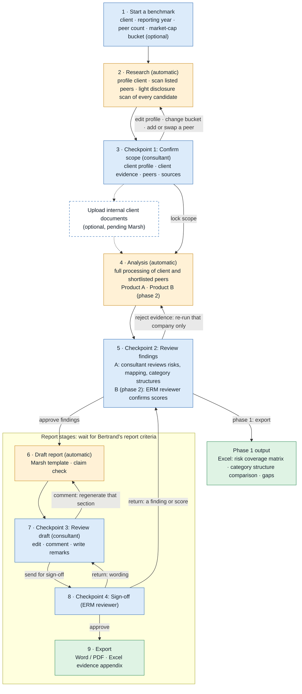

# User flow v2.1 (proposal)

Draft · 20 Oct 2026 · updated after the 15 Oct Marsh call · not yet reviewed with Marsh.

This redraws the human side of [diagram v1.2](erm-benchmark-flow-v1.2.drawio), which we presented on 15 Oct. The system steps underneath stay the same, so the build notes in [PLAN.md](../../PLAN.md) §6 still apply.

Built from: the vision document (24 Sep WIP, comments BL1–BL3), Marsh's Client X peer analysis appendix, the 13 Oct and 15 Oct Marsh call summaries, and diagram v1.2.

## In short

**Phase 1 is Product A (risk profile benchmarking).** On 15 Oct Marsh asked us to get it working end to end first. The consultant fills in one form and makes two decisions:

1. Confirm the scope: client profile, peers and sources, all on one screen.
2. Review the findings: the risks, their mapping, and how each company structures its risk categories.

The output is an Excel workbook.

**Phase 2 adds Product B (ERM framework benchmarking) and the drafted report.** The ERM reviewer confirms the Product B scores at checkpoint 2. Two more decisions follow: the consultant reviews the draft report, and the ERM reviewer signs it off. The report template waits for Bertrand's criteria email.

Everything between the decisions runs in the background. v1.2 had seven stops for people. This flow has four, and the phase 1 demo has two.

## Roles

| Role | Does |
|---|---|
| Consultant | Starts the benchmark, confirms scope, reviews Product A findings and the draft report, writes the remarks |
| ERM reviewer | Confirms Product B scores at checkpoint 2 and approves the client-facing wording at checkpoint 4 |
| Method owner | Maintains the standard setup (taxonomy, rubric, sector guides, report template). Not part of a run |

## Flow

Blue: a person acts. Amber: runs on its own (AI and code). Green: output. Dashed: optional. The boxed stages wait for Bertrand's report criteria. Product B parts are phase 2.

## Phase 1 demo: chat interface

The demo planned for the week after 15 Oct puts a chat window over the same fixed stages. It doesn't replace them.

- The consultant types the request, e.g. "benchmark City Developments for FY2025, large caps only". The bot asks for anything required that is missing.
- At checkpoint 1 the bot posts the client profile and the peer table, then waits. The consultant replies in plain language ("drop the second peer, add UOL", "include mid caps") and the bot re-runs that step. "Go" locks the scope.
- At checkpoint 2 the bot posts the coverage matrix and the category structure comparison, with quotes and page numbers, and takes edits the same way. "Export" returns the Excel workbook.
- The chat can only fill in the inputs and decisions of the fixed stages. It can't skip a stage, change their order or change the method, so two consultants still get comparable output (13 Oct).

The screens described below replace the chat later; the stages stay the same. Per the 15 Oct action items, the demo is deployed somewhere Marsh can try it, or shared as a video.

## Stage by stage

### 1 · Start a benchmark (consultant)

One form. Only the client name is required.

| Field | Default | Notes |
|---|---|---|
| Client | required | Resolved to the listed entity, with its exchange, ticker and market cap, e.g. City Developments Limited (SGX: C09) |
| Products | Risk profile (A) | Phase 2 adds ERM framework (B), or both |
| Reporting year | Latest year with a published annual report | |
| Context | optional | Sector, focus regions, notes such as "reviewing its risk categories" |
| Peers | 3 · listed companies · region first | Count, plus companies to include or exclude |
| Market-cap bucket | optional; blank scans all three | Limits the peer scan to one of three buckets. The ranges are set in the standard setup and are still to be confirmed with Bertrand. The bucket can also be set or changed at checkpoint 1 |
| Method | Current standard setup | Read-only. Recorded on every run |

**Start.** Nothing else is asked until checkpoint 1.

### 2 · Research (automatic)

Covers v1.2 steps 2–5 and the light part of step 6. The system:

- loads the standard setup
- profiles the client from live sources, with a source for each fact, including listing status and market cap
- checks the facts and flags related listed entities, such as a REIT the client sponsors (e.g. CDL Hospitality Trusts for City Developments), so their disclosures aren't credited to the client
- scans for peers among listed companies, within the chosen market-cap bucket if there is one, and proposes about twice as many as requested, as a recommended set plus alternatives
- runs a light disclosure scan for the client and every candidate. It finds the latest annual report and any sustainability report, downloads the annual report, and checks it with plain code: right company and year on the first pages, and whether it has a risk management section

The AI doesn't read any document yet. That happens at stage 4, and only for the client and the shortlisted peers. The consultant sees a progress feed and can leave. They are notified when checkpoint 1 is ready.

The light scan lets the consultant see disclosure availability before choosing peers. Marsh picks peers partly on what they disclose. Appendix A says: "the determination of relevant peers will also be based on the availability of publicly disclosed information".

### 3 · Checkpoint 1: Confirm scope (consultant)

The main decision of the run, on one screen with four panels.

**Client profile.** Facts with source links, and the related-entity warnings. Changing a fact that affects peer matching (a market, a segment) re-runs the peer scan.

**Client disclosure.** For a listed client the default is public evidence, and missing items read "insufficient evidence". A client with little or no disclosure is usually unlisted: on 15 Oct Bertrand noted that unlisted Singapore companies rarely publish risk management information. For such a client the consultant chooses how it appears in the benchmark:

- *Peer reference only.* There is no client column. Peers show current practice, and the consultant relates it to the client in the remarks. Marsh's Client X appendix works this way.
- *Add internal documents* (optional, pending Marsh). Adds a combined public-plus-internal view next to the public-only one (vision doc PB-02).
- *Use the parent group's disclosures*, labelled as group-level. Only if the consultant chooses it.

**Peer candidates.** A table with:

- listing status (exchange and ticker), market cap and its bucket
- HQ, operating segments, number of countries and main markets
- size bands: assets, revenue, EBITDA and employees (the columns of Marsh's Appendix A)
- documents found and their year, whether the annual report has a risk management section, and evidence availability
- related-entity warnings
- the AI's rationale and recommendation

The consultant can tick and untick candidates, swap in alternatives, add a company by name and edit the rationale. They can also set or change the market-cap bucket, which re-runs the scan. Peers are listed companies by default. An unlisted company added by hand carries a warning that its disclosure is likely to be thin. An "ask the AI" box takes requests such as "add a peer with a China portfolio" and updates the table.

**Sources.** The light-scan results for each selected company: document type, year and link. The consultant can add a URL, upload a public PDF, or mark a document n/a with a reason. The screen flags documents from the wrong year, documents from related entities, and press summaries.

**Lock scope and run analysis.** This fixes the peer set and sources for the run. The candidate table, the Y/N decisions and the rationales go into the report's peer selection section unchanged.

### 4 · Analysis (automatic)

Full document processing starts here, for the client and the shortlisted peers only: the AI reads the risk sections located in each document (v1.2 step 6b). The documents themselves were downloaded during the light scan. OCR for scanned pages is not set up yet; pages without a text layer are flagged. Then:

- **Product A** (v1.2 A1–A4): proposes the client's risk list from its profile, extracts each company's disclosed risks with quote and page, verifies every quote, and maps the risks to the standard taxonomy.
- **New in Product A:** extracts each company's own risk category structure from its risk section. That means the category names in the company's own words, how many there are, and any sub-categories.
- **Product B** (phase 2, v1.2 steps 7–10): runs in parallel with Product A.

The consultant sees a grid of companies against documents, Product A and, in phase 2, Product B, with a status in each cell. Problems found during full processing appear in the cell with a fix. Examples are a wrong year, a missing risk section or a failed download. The consultant can upload the right PDF, retry, or continue with that company marked "insufficient evidence". This is v1.2's source completeness check after step 6b, done per company rather than as a gate, so one problem doesn't hold up the other companies.

### 5 · Checkpoint 2: Review findings

One workspace, with a tab for each part.

**Risk coverage (Product A, consultant).** The risk coverage matrix: risks grouped by taxonomy category, set against the client and each peer.

- A cell shows a disclosed risk (hover for the quote, document and page) or "not publicly evident".
- Context-inferred risks show the sourced profile fact behind them.
- For each risk the consultant can accept, edit, remove or remap its category, and they can add new risks.
- The three gap types are listed automatically, and only when the client has its own disclosure.

**Risk category structure (Product A, consultant).** New, modelled on page 15 of the Client X appendix.

- There is one column per company. Each column lists the company's risk categories as it names them, the count, any sub-categories, and each category's mapping to the standard taxonomy.
- The AI notes the differences, for example a peer with a separate Safety & Security category, or no company with a Sustainability category.
- The consultant writes the remarks, as Marsh did in the appendix ("we recommend starting out with the following risk categories").

Bertrand raised this on 15 Oct as a way for clients to review how they structure their own categories.

**ERM framework scores (Product B, phase 2, ERM reviewer).** A heatmap of dimensions against companies, with 0–4 scores and the peer median, range and n.

- Opening a cell shows the rubric criteria and their answers, the quotes and page links behind each answer, the "not publicly evident" list and the confidence.
- The consultant can add notes.
- The ERM reviewer confirms each score, overrides it (reason required) or rejects a quote. Rejecting a quote re-runs that company and dimension only.
- The comparison table (v1.2 step 12) is built from confirmed scores only, as Bertrand described on 15 Oct.

**Review order.** A queue puts first what needs judgement: client cells, low confidence, outliers against the peer median and conflicting evidence.

**Leaving checkpoint 2:**

- *Phase 1:* **Export Product A workbook.** Available once every risk has a decision. The workbook holds the risk coverage matrix with quotes and pages, the category structure comparison, the gap list and the run record.
- *Phase 2:* **Approve findings and draft report.** Available once every risk has a decision and the ERM reviewer has confirmed every Product B score.

### 6 · Draft report (automatic; template waits for Bertrand's criteria)

On 15 Oct Bertrand offered to send high-level criteria for the report. Until they arrive, this outline is provisional. It is built from vision doc §9 and the Client X appendix:

1. Executive summary, written last
2. Client profile
3. Peer selection methodology: criteria (including listing and market-cap bucket), candidate table, Y/N and rationale (from checkpoint 1)
4. Risk profile benchmarking (A): coverage matrix, category structure comparison and gaps
5. ERM framework benchmarking (B, phase 2): score dashboard, then one table per dimension
6. Limitations: public disclosure doesn't prove effectiveness, a missing disclosure doesn't mean a missing practice, and no two organisations are the same
7. Evidence appendix (Excel)

The comparison tables follow the appendix: Component | Peer A | Peer B | Remarks. The appendix has no client column. Marsh relates each finding to the client in the Remarks. Adding a Client column when the client has its own public evidence would be our addition, to confirm with Bertrand.

Every factual sentence carries evidence IDs. The claim checker highlights any sentence without one instead of silently removing it.

### 7 · Checkpoint 3: Review draft (consultant)

The draft is reviewed section by section.

- The consultant edits text directly, or comments and the AI regenerates that section only. The executive summary is flagged if a change affects it.
- The consultant writes the Remarks and any recommendations. The AI stops at findings, as in v1.2.
- Claim-checker flags must be cleared before sign-off: fix the wording, attach evidence, or delete the sentence.

**Send for sign-off.**

### 8 · Checkpoint 4: Sign-off (ERM reviewer)

The ERM reviewer sees the draft with a review summary:

- method version
- peer set and rationale
- score overrides and their reasons
- rejected evidence
- any use of internal documents
- claim-check status

They approve, or return the draft with comments: to checkpoint 3 for wording, or to checkpoint 2 for a finding or score.

### 9 · Export

The export contains:

- the report in Word and PDF with Marsh branding
- the Excel evidence appendix, including the Product A workbook
- the run record, for reproducibility

The engagement is then marked as exported. To re-run next year, duplicate the engagement and change the reporting year.

### Home

Lists engagements by status: researching, waiting for you, in sign-off, exported. Actions: new benchmark, open, duplicate (vision doc FR-01).

## Other paths

| Situation | What happens |
|---|---|
| Client with little or no public disclosure (usually unlisted) | Decided at checkpoint 1 under "Client disclosure" |
| The market-cap bucket gives too few candidates | Checkpoint 1 says so and offers to widen the scan to the neighbouring bucket |
| Unlisted peer added by hand | Allowed, with a warning that its disclosure is likely to be thin |
| A shortlisted peer's documents fail full processing | Fixed in its grid cell at stage 4 |
| Peer added after scope is locked | Creates a new version of the run. The new company gets the light scan and then full processing. Existing decisions are kept |
| New annual report published | Duplicate the engagement with the new reporting year |

## Phase 1 test set

Phase 1 is developed and tested on the latest annual reports of the top 20–30 SGX-listed companies (15 Oct). We run each company through the live flow as the client and check the results. Bertrand is sending templates and criteria for this.

The Zoom summary calls these reports "training data", but no model is trained on them. They are the companies we test on. Nothing is pre-loaded into a database, in line with the 13 Oct decision.

## What changed from v1.2, and why

| | v1.2 | v2.1 | Why |
|---|---|---|---|
| Stops for people | 7 | 4 (phase 1 demo: 2) | Marsh want the AI to drive the run from the user's input (13 Oct). People step in only where a decision is needed |
| Phasing | Product A, then "Continue to Product B?" | Phase 1 is Product A. Phase 2 adds Product B, which runs in parallel with A and shares the same checkpoints | Start with Product A and get it working end to end (15 Oct) |
| Peer type | Direct competitors, disclosure benchmark, or both | Optional market-cap bucket (three buckets) in the peer scan. Listed companies by default. Market cap and listing status shown on the peer screen | Bertrand and Akshay (15 Oct) |
| Peers and sources | Peers confirmed before documents are found. Sources confirmed at a separate gate after step 6b | Light disclosure scan for every candidate before the peer decision. Full processing for shortlisted peers only. Peers and sources confirmed on one screen | Marsh weighs disclosure availability when picking peers (Appendix A). Full processing for a smaller set costs less |
| Client with thin disclosure | A rule inside A3, applied late | An explicit choice at checkpoint 1 | The Client X appendix has no client column. Unlisted companies rarely disclose (Bertrand, 15 Oct) |
| Product A output | Coverage matrix and gaps (A6). Excel and a short Word summary (A7) | Adds a risk category structure comparison. Phase 1 exports an Excel workbook; the Word report waits for Bertrand's criteria | Bertrand (15 Oct), Client X appendix p.15 |
| Product B score review | Separate step for the ERM reviewer (step 11) | The same ERM reviewer confirmation, inside checkpoint 2 | One review workspace for both products |
| Report layout | List of sections | Provisional outline. Comparison tables follow the appendix (Component \| Peer A \| Peer B \| Remarks) | Delivery-ready, standard reports (13 Oct). Final layout depends on Bertrand's criteria |
| Waiting and failures | Not shown | Progress grid. The completeness check after step 6b is done in each company's cell | Vision doc §10 (status, failure and retry states) |
| Interface | Screens implied | Phase 1 demo: chat over the same fixed stages. "Ask the AI" box at checkpoints later | Chatbot demo agreed on 15 Oct |
| Internal documents | Left out | Optional slot at checkpoint 1, pending Marsh | Bertrand's edits to Product A refer to non-public client information |

Where the v1.2 steps now sit:

| v2.1 stage | v1.2 steps |
|---|---|
| 1 Start | 1 |
| 2 Research | 2–5, and the light scan from step 6 |
| 3 Checkpoint 1 | ◇ Confirm peer set, ◇ Sources complete (light-scan results) |
| 4 Analysis | Rest of 6, 6b, A1–A4, plus the new category structure extraction. Phase 2: 7–10 |
| 5 Checkpoint 2 | A5, A6. Phase 2: 11, ◇ Evidence rejected, 12 |
| Phase 1 export | A7 (Excel only) |
| 6 Draft report | 13–14 |
| 7 Checkpoint 3 | 15–16, ◇ Changes needed |
| 8 Sign-off | 17 |
| 9 Export | 18 |

## Questions for Marsh this flow raises

The open questions in PLAN.md §11 still stand. This flow adds:

1. What are the three market-cap buckets? Should the scan default to the client's own bucket when none is chosen?
2. How is "top 20–30 SGX-listed" defined for the test set: STI constituents, or market cap on a set date?
3. For an unlisted client with little public disclosure, is "peer reference only" the right default? It matches the Client X appendix.
4. Bertrand's report criteria: should the report keep the appendix layout? Should we add a Client column when the client has its own public evidence? Does Product A get a drafted report with ERM reviewer sign-off, or only the workbook?
5. Phase 2: once the low-confidence Product B scores are reviewed, may the ERM reviewer confirm the rest in bulk?
6. Much of the Client X appendix rarely appears in public filings: risk register fields, KRI use, tools such as OneDrive. Did that detail come from public sources? From public data alone, the tool will mark most of it "not publicly evident".
